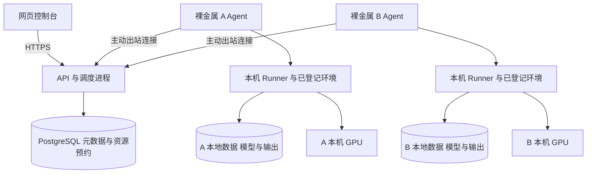
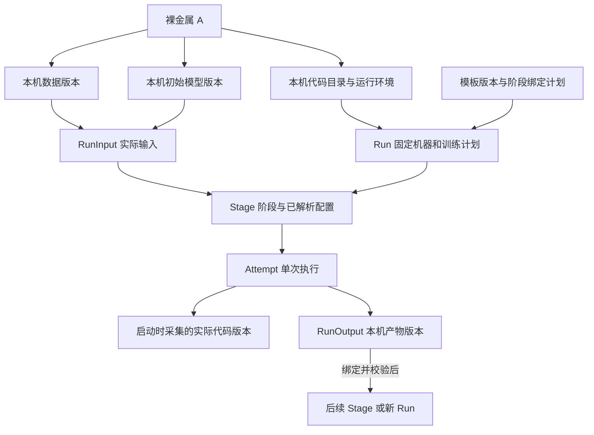

# VLA 训练平台详细设计

> 裸金属同机训练与训练资产关联管理

版本 V1.0    日期 2026年10月15日

本次补充：每次训练启动时自动记录并展示实际使用的 openpi-umi 代码版本，随训练和产物保留。

本文定义团队 VLA 训练平台的产品行为、系统结构、数据模型、接口和验收标准，供前端、后端、训练适配与运维共同实施。

**首期采用固定裸金属资源池。数据、初始模型、归一化资产和训练输出均保存在选定机器本地；中央平台统一管理元数据、资源预约、训练过程与资产血缘。**

| 设计决定 | 首期约定 |
| --- | --- |
| 计算边界 | 一个 `Run` 固定一台机器；支持本机单卡或多卡 |
| 数据边界 | 只使用本机已登记且通过校验的资产版本 |
| 文件操作 | 原地登记；只读使用输入；输出写入独立本地目录 |
| 明确排除 | 跨机同步、多副本调度、统一共享存储、自动租退机器 |
| 代码版本 | Agent 在实际启动时采集仓库、分支、完整提交与本地修改状态，保存在本次训练记录中 |
| 算法接入 | SFT、MEM、ReCap、RLT 使用版本化适配器；按算法逐项验收 |
| 关联主线 | 机器 → 输入数据与模型 → 训练阶段与执行 → 输出模型 |

适用读者：产品负责人、前后端工程师、算法工程师、测试及运维人员。

文档中的接口、数据库和默认阈值为设计约定；代码能力依据附录中的固定版本核查。发布模板前必须完成相应运行验收。

## 阅读导航

- [01 目标与范围](#01-目标与范围)
- [02 用户角色与操作流程](#02-用户角色与操作流程)
- [03 系统结构与技术选择](#03-系统结构与技术选择)
- [04 页面结构与导航](#04-页面结构与导航)
- [05 训练向导与详情行为](#05-训练向导与详情行为)
- [06 本地资产登记与版本契约](#06-本地资产登记与版本契约)
- [07 关联关系与训练血缘](#07-关联关系与训练血缘)
- [08 数据库核心实体](#08-数据库核心实体)
- [09 训练实体与数据库不变量](#09-训练实体与数据库不变量)
- [10 模板与训练适配接口](#10-模板与训练适配接口)
- [11 MEM 多阶段接入](#11-mem-多阶段接入)
- [12 ReCap 与 RLT 接入边界](#12-recap-与-rlt-接入边界)
- [13 Agent 与运行环境](#13-agent-与运行环境)
- [14 训练代码版本记录与展示](#14-训练代码版本记录与展示)
- [15 单机调度与资源预约](#15-单机调度与资源预约)
- [16 状态机与阶段编排](#16-状态机与阶段编排)
- [17 Checkpoint 与故障恢复](#17-checkpoint-与故障恢复)
- [18 业务 API 设计](#18-业务-api-设计)
- [19 训练 API 与提交示例](#19-训练-api-与提交示例)
- [20 错误协议与幂等一致性](#20-错误协议与幂等一致性)
- [21 监控指标与告警](#21-监控指标与告警)
- [22 权限和部署运维](#22-权限和部署运维)
- [23 验收用例与质量目标](#23-验收用例与质量目标)
- [24 交付阶段与开发拆分](#24-交付阶段与开发拆分)
- [25 本地目录和事件示例](#25-本地目录和事件示例)
- [26 依据与待核实接入项](#26-依据与待核实接入项)

## 01 目标与范围

平台让训练成员通过网页选择本机数据、模型和训练模板，完成资源排队、训练启动、监控、结果追溯及后续微调。复杂参数由经过验证的模板提供默认值，Run 的不可变计划与各 Stage 的实际解析配置分别留档。

| 编号 | 必须满足的设计约束 |
| --- | --- |
| C01 | Run、所有输入 AssetVersion、执行环境和所有输出的 node_id 必须一致。 |
| C02 | 一个 Run 的全部 Stage 固定在同一 Node；不跨机器组成分布式任务。 |
| C03 | 首期不提供跨机同步、跨机复制任务、物理副本表或自动搬运接口。 |
| C04 | 数据与模型通过原地登记接入；首期不提供物理删除，归档只改变选择资格。 |
| C05 | 任务启动只能引用发布模板、登记环境和资产 ID，禁止用户提交任意 shell。 |
| C06 | 记录完整输入和输出血缘；机器离线不抹除资产和历史训练。 |
| C07 | 训练完成、评估通过与机器人效果验证分别记录，禁止互相替代。 |
| C08 | 每次 Attempt 启动前采集并保存实际代码版本；与 Run 预检基线比较，变化时不静默使用新代码。 |

### 交付范围

首期建设工作台、机器资源、数据、模型、模板、训练详情、项目权限及告警。云上与自有裸金属采用相同接入方式；云厂商名称和租赁信息作为资源属性登记。云 API、自动扩缩容、Kubernetes、跨机训练、在线机器人控制不纳入本设计的实施任务。

支持多种训练是平台目标。SFT、MEM 和 ReCap 按已定位源码实施；RLT 在明确代码来源、数据契约和停止恢复语义后接入。界面仅允许选择已发布且验收通过的模板。

## 02 用户角色与操作流程

| 角色 | 主要权限 |
| --- | --- |
| 平台管理员 | 接入机器、登记代码目录与环境、管理受管目录、用户和机器授权、处理异常预约。 |
| 项目负责人 | 管理项目成员、发布或归档项目资产、设定项目并发配额、查看项目训练。 |
| 训练成员 | 登记本项目资产草稿、使用授权机器、创建及管理本人训练、查看项目成果。 |
| 只读成员 | 查看被授权的机器摘要、资产、训练状态及评估；不启动训练。 |

### 首次接入

管理员安装 Agent 并绑定机器，登记数据、模型、代码和输出根目录，发布可用环境 profile。项目成员原地登记现有数据与模型，完成格式和路径核验。算法维护者发布模板后，训练成员即可创建任务。

### 常规训练

选择项目 → 选择机器 → 选择本机数据与初始模型 → 选择兼容模板 → 填写少量参数 → 预检 → 提交排队 → 观察训练 → 查看产物和评估 → 登记选定模型。变更机器后清空输入选择并重新预检。

### 已有模型继续训练

用户从模型详情选择“开始新训练”，携带模型版本与 node_id 进入向导。数据选择范围限定为该机；修改数据或参数会产生新的 Run，并保留 parent model 关系。恢复中断训练通过阶段的“恢复执行”入口完成。

## 03 系统结构与技术选择

中央控制面保存元数据并处理权限、调度和查询。Agent 主动连接控制面，执行本机文件检查和训练控制；独立 Runner 承载训练进程，避免网页或短暂连接中断影响训练。



*图 1 控制面与裸金属执行层*

| 组件 | 首期技术与责任 |
| --- | --- |
| 网页端 | React 与 TypeScript；成熟组件库；图表、表单、联动选择和血缘视图。 |
| API 与调度 | Python FastAPI；业务模块单体部署，调度循环独立进程。 |
| 数据库 | PostgreSQL；业务状态、资源预约、事件、审计及事务 outbox。 |
| Agent 与 Runner | Python；本地 SQLite 记录执行事实；复用登记的 uv 或 venv 环境。 |

## 04 页面结构与导航

| 页面 | 列表与详情的主要内容 | 核心动作 |
| --- | --- | --- |
| 工作台 | 我的任务、异常、排队原因、近期成果 | 进入任务；处理告警 |
| 机器资源 | 在线状态、GPU 预约与实际占用、磁盘、本机资产和历史任务 | 查看；管理员维护 |
| 数据中心 | 项目、机器、版本、规模、协议、质量及使用记录 | 登记；校验；归档 |
| 模型中心 | 机器、版本、来源训练、初始化关系、恢复能力和评估 | 登记；新建训练 |
| 模板中心 | 用途、阶段、兼容规则、环境要求、版本和验证状态 | 查看；管理员发布 |
| 训练中心 | 机器、模板、状态、进度、创建者与时间筛选 | 创建；取消；对比 |
| 训练详情 | 输入输出、阶段、执行历史、曲线、日志、checkpoint | 取消；恢复；选定成果 |
| 项目管理 | 成员角色、机器授权、并发配额、告警及审计 | 授权；配置 |

### 统一交互规则

所有列表保留筛选条件并支持游标分页。状态必须同时显示中文文字和图标，不能仅靠颜色。空列表区分“尚未登记”“没有权限”“本机没有兼容资产”。机器失联时历史内容可读，启动入口禁用并说明最近心跳时间。

界面直接使用业务名称；机器 ID、路径、代码提交和原始配置放入详情。错误提示包含问题、影响及可执行的修复入口，不把 Python traceback 作为唯一提示。

## 05 训练向导与详情行为

### 新建训练向导

| 步骤 | 输入和限制 | 通过条件 |
| --- | --- | --- |
| 选择机器 | 展示授权机器的健康状态、卡型、单卡显存与空闲预约 | 节点在线；允许本项目使用 |
| 选择资产 | 只列本机 READY 且未归档的数据、模型、统计；可选多个数据版本 | 全部输入同机且同项目可用 |
| 选择模板 | 按算法和数据协议过滤；展示本机环境及预检读取的代码提交；MEM 可选完整流程或已有记忆模型的 Stage 2 | 模板发布；环境和入口兼容 |
| 设置参数 | 名称、训练档位、卡数、步数；高级项来自 schema 白名单 | 参数范围与组合合法 |
| 预检提交 | 展示解析配置、可用资源、检查结果及排队说明 | 硬性检查通过；提交时复检 |

GPU 暂时被预约可以正常排队；机器离线、协议不匹配、文件缺失、显存档位未经验证或输出空间不足时不允许启动。预检只生成报告，不占用 GPU，也不保证稍后的资源可用。

### 训练详情

顶部展示 Run 状态、机器、当前阶段、最近有效 step 和异常；阶段区展示依赖及每次 Attempt；曲线区按阶段和执行切换；日志支持尾随、暂停显示、搜索和断线续读。资产区可跳转到输入、归一化、选定 checkpoint 和输出模型。

取消先显示“取消中”，收到进程退出确认后才结束。只有适配器已声明并验证能力时显示“保存后停止”。修改参数后再次训练创建新 Run；同一阶段失败恢复创建新 Attempt。

## 06 本地资产登记与版本契约

首期使用 Asset 和 AssetVersion 两层目录。每个 AssetVersion 只有一个 node_id 和一个本地目录，不建立副本层。不同机器上的文件分别登记，平台不自动合并、同步或搬运。

### 登记与校验

用户选择授权机器及受管目录后提交扫描。Agent 返回支持格式的候选项和小型元信息；用户补充项目、名称及协议后异步生成清单并校验。状态依次为 DRAFT、CHECKING、READY；异常使用 INVALID 或 MISSING。物理可访问性由节点健康单独表示。

| 资产类型 | 必须记录的契约 |
| --- | --- |
| DATASET | 格式版本、episode 数、相机键、state/action 维度、动作坐标和旋转编码、频率、history/horizon、划分清单；标签目录以 metadata 子类型登记。 |
| MODEL | 架构、训练后端、配置、权重位置、来源、输入输出协议、norm 引用；区分仅参数和完整训练状态。 |
| NORM | 统计方法、字段及维度、transform 版本、源数据版本、训练划分和统计范围。 |
| CHECKPOINT 子类型 | 保存在 MODEL 类型下；记录 stage、attempt、step、保存完成标志及支持恢复的状态范围。 |

发布 READY 后冻结机器、路径、清单和协议。文件发生修订时创建新版本；外部修改导致原版本校验状态失效。归档只从新任务选择器隐藏，不删除文件或历史关系。模型所需 norm 不因加载 params 自动补齐，必须作为显式输入解析。

首次登记只读取原始文件。大文件清单后台生成并展示进度；后续使用增量检查和最近核验时间。文件级校验完整性与数据质量报告分别记录。

MEM 的原始标签、ReCap 的成败元数据作为显式输入，使用 RunInput 的 metadata 角色绑定本机 DATASET metadata 子类型；禁止在未登记的外部目录中隐式取依赖。

## 07 关联关系与训练血缘

所有页面沿同一组结构化关系查询。关联以资产版本和 RunInput／RunOutput 为依据，文件路径和用户描述仅用于定位及说明。



*图 2 单机范围内的资产和训练血缘*

机器详情展示本机全部获授权资产和任务。数据详情反查使用它的实验。模型详情展示来源训练、初始模型和后续微调。训练详情固定展示数据、norm、模型、模板、代码及输出，可继续下钻到 Stage 和 Attempt。

人工导入成果允许没有来源 Run，但标记“外部登记”。MEM 完整流程中第一阶段产物以显式依赖绑定第二阶段；只训练 Stage 2 时可以引用本机已有记忆模型。恢复某阶段指向父 checkpoint，保持与新模型微调关系不同的边类型。

## 08 数据库核心实体

主键采用 UUID；时间以 UTC 存储并按用户时区展示，默认 Asia/Shanghai。关键关联使用列和外键，变化较大的协议使用 JSONB。业务表含 created_at、updated_at，变更接口记录操作者。

| 实体 | 核心字段 | 约束或用途 |
| --- | --- | --- |
| Project 与 Member | project_id、user_id、role、status | 项目角色唯一；禁用用户不可提交 |
| Node 与 NodeGrant | id、agent_id、health、last_seen、roots、output_root；project_id | 项目使用授权和机器健康分开 |
| GpuDevice | node_id、gpu_uuid、型号、显存、指标、外部占用 | 以 UUID 识别卡；不使用可变索引作身份 |
| RuntimeProfile | node_id、code_dir、解释器、实际导入来源、依赖指纹、能力、状态 | 登记本机训练环境；代码实际提交由预检与启动时读取 |
| Asset | id、project_id、kind、name、owner、archived_at | kind 为 DATASET、MODEL、NORM |
| AssetVersion | id、asset_id、project_id、node_id、version、path、manifest、schema、state | 版本标签在资产内唯一；发布后固定 |
| NormSource | norm_version_id、dataset_version_id、project_id、node_id | 支持混合数据统计；两端同机 |
| TemplateVersion | key、version、adapter、parameter_schema、defaults、stages、rules、tested_code_revision | 版本不可变；仅 PUBLISHED 可提交 |

EvaluationReport 关联本机模型版本，保存评估类别、协议、样本或试验次数、指标、证据文件位置及登记人；离线、仿真、真机报告各自独立。文件完整、可加载和效果评估分别记录。

Asset 归属项目，AssetVersion 归属机器。首期公共基础模型由管理员在有权限项目分别登记本机只读引用，可指向同一本地目录；该过程不产生文件复制。

## 09 训练实体与数据库不变量

| 实体 | 核心字段与用途 |
| --- | --- |
| Run | project_id、node_id、template_version_id、runtime_profile_id、code_expectation、name、plan_config、plan_digest、state、desired_state、creator。 |
| Stage | run_id、stage_key、顺序、依赖、状态、resolved_config、resolved_config_digest；模板阶段实例，Run 内 stage_key 唯一。 |
| Attempt | stage_id、run_id、attempt_no、execution_token、state、output_dir、resume_checkpoint_id、code_snapshot、进程摘要、exit_code、failure_code。 |
| StageInputBinding | run_id、stage_id、project_id、node_id、role、ordinal、source_kind；直接资产或上游输出的输入绑定计划。 |
| RunInput 与 RunOutput | run_id、stage_id、project_id、node_id、role、ordinal、asset_version_id；仅记录已经确定的实际资产。 |
| GpuAllocation | node_id、gpu_uuid、attempt_id、reservation_token、generation；仅存活动预约，历史另记事件。 |
| Event 与 Metric | attempt_id、seq、phase、step、时间、内容；稳定序列去重，支持增量查询。 |
| Outbox 与 Idempotency | 事务内写调度意图；幂等键作用域、请求摘要、结果和保留时间。 |
| Alert 与 AuditLog | 告警指纹、状态、证据；操作者、对象、动作、结果及 request_id。 |

### 同机约束和唯一性

Run 和 AssetVersion 分别建立 UNIQUE(id, project_id, node_id)。RunInput／RunOutput 的两组复合外键同时引用这两个组合；Stage 通过 (stage_id, run_id) 外键归属 Run。norm 来源使用同样约束；Run 的 (runtime_profile_id, node_id) 复合外键保证环境同机。Run.code_expectation 和 Attempt.code_snapshot 使用 JSONB 保存版本观测，不建立独立代码版本实体。服务层再检查类型、状态、权限及协议。

GpuAllocation 使用 PRIMARY KEY(node_id, gpu_uuid)，多卡整组在同一事务预约。execution_token 唯一；Attempt 在 Stage 内按 attempt_no 唯一。输入按 (run_id, stage_id, role, ordinal) 唯一，stage_id 不允许为空。资产和训练的 node_id 在发布或提交后禁止修改。外键采用 RESTRICT。

索引覆盖 node_id+state、project_id+created_at、asset_id+version、run_id+stage_key、attempt_id+seq。机器离线状态与资产文件完整性分列保存，避免失联被误写为资产删除。

### 多阶段输入绑定与配置冻结

Run 创建时冻结 `plan_config`：模板版本、机器、环境 profile、代码预检基线、根输入资产、参数和阶段绑定计划。下游尚未生成的产物以符号引用保存，不伪造 `asset_version_id`，也不在创建 Run 时提前填入旧默认权重。

`StageInputBinding` 使用两种来源：

| source_kind | 必填字段 | 校验规则 |
| --- | --- | --- |
| `ASSET_VERSION` | `asset_version_id` | 引用已登记资产；复合外键约束同项目、同机器；类型和 READY 状态由服务端校验。 |
| `STAGE_OUTPUT` | `upstream_stage_id`、`upstream_output_role`、`selection_rule` | 上游 Stage 必须属于同一 Run 且为模板允许的前置阶段；不能同时填写直接资产 ID。 |

每条绑定只能选择一种来源。唯一键为 `(stage_id, role, ordinal)`；上游归属通过 `(upstream_stage_id, run_id)` 复合外键约束。已发布模板定义无环依赖，用户不能自行添加任意阶段边。

初始预检检查所有直接资产、预期输出协议和依赖闭包。下游未来产物尚不存在时保持 `BLOCKED`，这属于正常流程。上游产物完成后，服务端执行以下事务：

1. 锁定下游 Stage，确认尚未开始执行。
2. 核验上游选定产物确属对应 `RunOutput`，文件完整、READY，并通过阶段门槛。
3. 复检实际产物与下游的机器、项目和协议兼容性。
4. 物化对应 `RunInput`，生成并冻结该 Stage 的 `resolved_config` 和摘要。
5. 全部输入绑定完成后将 Stage 从 `BLOCKED` 转为 `QUEUED`，同时写入 outbox。

`selection_rule` 由模板固定，可为显式人工选定或按已定义验证指标选择。需要人工选择时，下游显示 `AWAITING_OUTPUT_SELECTION` 排队说明。输入一经物化并入队即固定；改选产物或更改训练参数需要新 Run。一次 Attempt 仍单独保存启动参数、恢复 checkpoint 和实际环境快照。

例如，MEM 完整流程的绑定计划如下。ID 为示意缩写：

```json
[
  {
    "stage_key": "memory_pretrain",
    "role": "dataset",
    "source_kind": "ASSET_VERSION",
    "asset_version_id": "dataset-v3"
  },
  {
    "stage_key": "action_train",
    "role": "memory_model",
    "source_kind": "STAGE_OUTPUT",
    "upstream_stage_key": "memory_pretrain",
    "upstream_output_role": "memory_model",
    "selection_rule": "explicit_selected_checkpoint"
  }
]
```

以上为模板实例化示例：`upstream_stage_key` 在创建 Run 时解析为该 Run 中的 `upstream_stage_id`。只训练 Stage 2 时，`memory_model` 改用 `ASSET_VERSION` 直接引用本机已有记忆模型。

## 10 模板与训练适配接口

模板固定算法适配器版本、输入契约、阶段、默认值、可修改字段、资源档位、兼容环境和输出规则。适配器实现后端训练细节。网页表单由 parameter_schema 和兼容规则生成，用户无法绕过模板选择任意命令。模板中的 tested_code_revision 记录已验收的基线提交，实际运行版本以 Attempt.code_snapshot 为准；运行前仍需通过入口和协议兼容检查。

| 适配器操作 | 输入与输出 |
| --- | --- |
| validate | 检查输入资产、参数、恢复模式和环境；返回结构化错误及警告。 |
| resolve | 把资产 ID 解析为本机路径；生成最终配置和参数摘要。 |
| prepare | 创建本机工作目录、必要派生数据和配置；不改发布输入。 |
| build_launch | 返回解释器、argv、允许环境变量和 cwd；禁止拼接任意 shell。 |
| observe | 将阶段、step、指标、异常和 checkpoint 信号转成统一事件。 |
| cancel 与 save_stop | 按能力执行停止；返回过程状态，最终以进程退出确认。 |
| restore 与 finalize | 校验恢复范围；检查输出、登记产物并生成关联。 |

### 能力与版本发布

模板声明 supports_resume、resume_scope、supports_save_and_stop、metric_definitions、checkpoint_format 和 compatible_profiles。资源档位绑定具体 recipe、卡型、单卡显存、卡数、batch、精度和已测峰值；测量前标为待验证。

新增版本流程为登记源码和环境 → 固定小数据运行 → 验证梯度与产物 → 中断恢复演练 → 兼容与负例检查 → 发布。SFT、MEM、ReCap、RLT 分别保留验收记录。代码中存在入口文件不等于模板已可发布。

## 11 MEM 多阶段接入

MEM 使用 `mem_exp` 固定提交 `269354b` 的已有语义记忆流程。阶段 1 入口为 `scripts/mem/train_semantic_memory.py`，基线 recipe 为 `shellgame_semantic_memory_pretrain`；阶段 2 入口为 `scripts/mem/train_mem.py`，基线 recipe 为 `pi0_mem_semantic_action_shellgame_eef7`。具体 recipe 和数据协议随模板固定。[S2][S3]

| 平台模板 | 阶段与依赖 | 必须校验 |
| --- | --- | --- |
| MEM 完整流程 | 记忆预训练 → 验证并选定 checkpoint → 策略训练 | 第二阶段显式绑定本次选定 memory 参数 |
| MEM 策略微调 | 选定本机已有 memory model → Stage 2 | 不自动寻找默认路径；输入与动作协议匹配 |
| MEM 真机 Stage 2 | 采用真机专属 recipe 与已登记初始模型 | 与通用 baseline 分别登记环境和资源档位 |

跨阶段加载参数属于 warm start，各阶段建立自己的训练状态。阶段内中断使用该适配器支持的 resume。若第二阶段没有显式 memory input，平台拒绝启动，禁止沿用源码中的旧默认初始化。[S2]

### 不同 recipe 保持独立协议

通用 ShellGame baseline 使用 60 帧历史加当前帧及 absolute EEF7。真机 Stage 2 文档对应 241 帧历史加当前帧，以及相对当前 link6 的 10D action；state、norm 和冻结规则也要随 recipe 校验。[S3][S4]

阶段 1 指标记录 initial、relation、stage memory 与 final memory 的定义和条件。使用真实语义事件进行 teacher forcing 的指标必须注明条件，不能标成纯视觉闭环成功率。策略阶段分别展示 action 指标及外部评估报告。[S3]

所有阶段使用同一 node_id。上游产物完成、登记 READY 并满足阶段门槛后，下游才入队。验证不通过时保留产物和失败原因，不启动下游。

## 12 ReCap 与 RLT 接入边界

已定位 recap 固定提交 944f093 的训练与标注入口。平台为其建立显式阶段，而不是一个算法名称开关。[S5][S7]

| 阶段 | 已定位入口 | 产物或约束 |
| --- | --- | --- |
| 价值模型 | `scripts/train_value.py`；recipe 为 `pi0_value_umi_bimanual_headview_depth`，多数据集单独模板 | 产生 value model；登记输入和评估 |
| 价值与优势标注 | scripts/lerobot_value_infer.py | 生成 predicted_value、advantage、is_positive 等训练字段 |
| ACP 策略 | `scripts/train.py`；recipe 为 `pi05_acp_umi_bimanual_headview_depth` | 输入派生数据、初始策略及统计；产生策略模型 |

标注脚本会写入数据文件。适配器必须在本机 scratch 目录创建工作副本，完成标注与校验后发布为新的派生 DATASET 版本，并记录 parent dataset 与 value model。原始 READY 版本保持只读；预检计入本机工作副本和输出的磁盘需求。[S5]

ReCap recipe 的相机、动作、标注字段和多数据集采样规则分别校验。train_advantage.py 不作为 ACP 默认入口，实际流程以发布模板固定的入口为准。各阶段输出、指标语义及恢复等级须运行验收后开放。

成败标签必须明确；若数据确为全成功样本，在资产协议中显式声明。不能把缺少 success 字段静默解释为混合数据全部成功。标注参数、阈值、value model 和任务长度规则随派生数据版本保存。

### 价值目标列的准备与准入

`lerobot_value_infer.py` 要求输入 parquet 已包含 `value_target`；缺列时会报错。`train_value.py` 可以在训练时在线计算目标，但不会自动把这列写回数据，不能依赖“价值模型训练已结束”来推断标注输入已准备完成。[S8]

适配器必须采用以下两种准入方式之一：

- 使用本机已登记、包含有效 `value_target` 的数据版本。
- 增加本机 `prepare_value_targets` 准备阶段，在工作副本中按已确认公式物化目标列，校验后发布新的 DATASET 版本。该准备器属于需要实现并验收的适配工作，不宣称仓库已有通用可用实现。

如果目标列准备器尚未验收，模板只能接受第一种输入。混合成败数据必须有真实成败元信息；全成功数据声明和相关工具不能用于替代混合数据标签。目标公式、失败惩罚、任务长度规则、生成代码和字段完整性报告随派生版本保存。

完整依赖为：原始数据 → 目标列就绪的本机派生数据 → value 模型 → 优势标注数据 → ACP 模型。已有目标列、value 模型或优势标注数据可以通过独立模板复用。所有阶段依赖均通过 `StageInputBinding` 解析，既有输入保持只读。

### RLT 的接入门槛

RLT 的源码仓库、提交和已验证启动方式尚需确定。设计预留同一适配接口，首期接入范围限本机已有 replay 数据的离线训练。在线采集、控制切换、机器人复位和策略下发属于后续独立设计。

发布前必须明确 replay 文件与索引是否完整、奖励和终止语义、actor/critic 更新范围、采样与归一化、checkpoint 组成和恢复规则。若配置只做数据采集而没有参数更新，界面应标为采集或导入记录，不能标为已完成模型训练。

## 13 Agent 与运行环境

每台机器安装一个受限服务账号运行的 Agent，使用独立机器凭据主动连接中央 HTTPS。Agent 负责本机校验和观测；独立 Runner 承载训练进程组，Agent 重启后按 attempt_id 发现并接管已有运行。

| 协议项 | 首期默认与行为 |
| --- | --- |
| 心跳 | 每 10 秒独立发送；包含版本、任务摘要、GPU UUID、占用、磁盘与事件确认游标。 |
| 命令获取 | 出站长轮询，一次最长 25 秒；重连指数退避与抖动，上限 30 秒。 |
| 命令结构 | command_id、node_id、attempt_id、type、token、generation、payload_version、参数摘要。 |
| 回执 | RECEIVED 为持久化；ACCEPTED 为检查通过；APPLIED 为动作落实；REJECTED 附原因。 |
| 事件上传 | attempt_id + seq 去重；服务端提交后返回已确认游标；允许重传。 |
| 支持指令 | START、CANCEL、SAVE_AND_STOP、QUERY、RECONCILE、CAPTURE_CODE_VERSION；版本采集只读，其他能力按适配器开放。 |

### 已登记环境

首期复用本机 uv 或 venv profile，登记本机 code_dir、解释器路径、实际模块导入位置、锁文件摘要、实际依赖指纹及 CUDA/驱动兼容信息。代码版本在预检和每次实际启动时采集。管理员验证后发布；启动前检查漂移。训练提交时不自动升级代码或安装依赖。Docker 可作为可选 profile，协议保持一致。

Agent 在允许的代码、数据、模型和输出根目录内操作。Runner 接收结构化 argv 和白名单环境变量；数据和初始模型只读使用。profile 只允许管理员变更，训练成员不能提交解释器和任意执行文件。

```text
POST /agent/v1/register                 绑定一次性登记凭据
POST /agent/v1/heartbeat                上报节点和运行摘要
GET  /agent/v1/commands?after_seq=       长轮询领取命令
POST /agent/v1/commands/{id}/ack         回执动作状态
POST /agent/v1/events/batch             批量事件并返回确认游标
```

## 14 训练代码版本记录与展示

### 需求与范围

用户在调用训练时必须知道本次实际使用的 openpi-umi 代码版本。该信息随训练记录保存，并可从输出模型反查。首期只实现自动采集、记录和展示，不建设独立版本管理中心，不增加版本选择、升级或回退操作。

### 每次实际启动采集的内容

| 字段 | 内容 |
| --- | --- |
| 仓库与目录 | 脱敏仓库 URL、实际代码根目录和工作目录 |
| branch / tag | 当前分支与可确认的 tag；detached HEAD 如实标记，不猜测分支 |
| commit_sha | 实际 Git HEAD 的完整 SHA；页面显示短 SHA 并可展开完整值 |
| commit_message / committed_at | 提交说明和提交时间，便于识别版本 |
| dirty | 是否存在未提交源码修改；不能只用 commit SHA 代表有修改的工作区 |
| changes_digest / evidence | 已暂存和未暂存差异摘要、影响执行的未跟踪源码清单；可获取的 diff 文件保存在本次 Attempt 的本地输出目录 |
| module_origin | 在实际训练解释器和环境下确认的 openpi 模块来源，避免记录 A 目录但导入 B 目录 |
| captured_at / completeness | 采集时间、完整性及缺失项；使用 submodule 时附实际提交和修改状态 |

采集来自本机真实训练目录，属于只读检查，不执行拉取、切分支、提交或清理命令。Git revision 与 submodule 信息按其实际状态读取。[S9][S10]

未提交修改允许被记录，但界面必须显示“有本地修改”，保存可获取的差异，并说明记录完整性；不能将 SHA 展示为完全等价于实际源码。未能完整保留变更时标记“源码记录不完整，不能据此保证精确复现”。如果连有效提交或真实导入来源都无法确认，则返回明确错误，不以未知版本静默启动。

### 预检与真正启动分开记录

```text
预检时 Agent 读取代码信息
  → 中台展示并保存 Run.code_expectation
  → 任务排队
  → 真正启动前，在实际训练环境再次采集
  → 保存 Attempt.code_snapshot
  → 一致性及兼容检查通过后启动训练脚本
```

`Run.code_expectation` 是提交时的代码基线；`Attempt.code_snapshot` 是该次真实执行前采集到的版本，后续不可覆盖。所有 Stage、重试和恢复分别采集，并与原 Run 基线比较。服务端直接绑定 Agent 的预检结果，浏览器不手工填写或伪造 SHA。

比较项包括代码目录与模块来源、完整 SHA、可获取的 diff 摘要和影响执行的未跟踪源码清单。只比较 SHA 或 dirty 布尔值，无法识别工作区已经改变。排队后发现变化时阻止该次启动，返回 `CODE_CHANGED_SINCE_PREFLIGHT`；重新预检后创建新 Run，原 Run 记录不变。存在 dirty 且无法可靠比较变更时也不自动派发。

训练运行期间约定不修改代码目录；结束时再记录一次版本检查。检测到变化则标记“运行期间代码发生变化”，保留起始与结束证据，不宣称整个运行过程使用了完全相同源码。平台不因此自动切版本或覆盖文件。

### 界面与数据存储

提交确认页显示预检代码信息，训练详情中显示每次 Attempt 的实际版本，模型详情链接到来源 Attempt。页面中的示例如下，SHA 在数据库中保存完整值：

```text
代码库：ThorHez/openpi-umi
分支：mem_exp
提交：269354b（可展开完整 SHA）
本地修改：无
代码目录：/data/code/openpi-umi
采集时点：本次训练实际启动前
```

使用现有 Run 和 Attempt 字段保存快照，不新增仓库、代码版本或本机部署记录表。`GET /runs/{id}` 在各 Attempt 下返回 `code_snapshot`；预检接口返回代码基线。Agent 通过既有事件通道上传元数据，diff 留在本机任务目录，只登记摘要、位置和完整性，服务端做权限与脱敏检查。

实现集中在 Agent 的启动前版本采集和中台训练详情展示，不增加独立 Git 管理页面。原训练库及其环境仍按已有方式维护。

## 15 单机调度与资源预约

每个项目可设并发 GPU 配额；调度在用户选定 Node 内执行。满足配额和协议后，同优先级按提交顺序排队。一个阶段需要多张卡时一次性获得整组，避免占着部分 GPU 等待其余卡。

```text
事务开始
  锁定节点调度状态并复检在线性、资产和 profile
  选择无平台预约且无外部占用的本机 GPU UUID
  插入 Attempt 与整组 GpuAllocation
  写入带 execution_token 的 START outbox
事务提交
Agent 再次检查占用与输入，然后幂等启动 Runner
```

GpuAllocation 的唯一键防止多个调度进程重复预约同一张卡。API 创建与 outbox 同事务；命令重发由 Agent 的 command_id、attempt_id 和本地锁去重。GPU 利用率、显存和是否已预约分别展示。

### 外部占用与释放

Agent 通过本机设备信息识别外部进程。发现冲突返回 EXTERNAL_GPU_BUSY，任务保留在队列或按策略失败，不终止外部进程。拥有主机权限的手工作业仍可能绕开平台，需要机器使用约定和持续观测。

只有确认本次 Runner 与进程组退出后才释放预约。心跳超时、命令未确认或点击取消都不能直接释放。失联的活动卡保留预约并隔离调度；令牌代次用于拒绝陈旧命令，不能代替实际退出确认。

## 16 状态机与阶段编排

| 对象 | 状态集合 | 聚合原则 |
| --- | --- | --- |
| Run | QUEUED、RUNNING、CANCELLING、SUCCEEDED、FAILED、CANCELLED、UNKNOWN | 整体结果和用户期望状态；任何未确认活动执行使事实状态 UNKNOWN。 |
| Stage | BLOCKED、QUEUED、RUNNING、FINALIZING、SUCCEEDED、FAILED、CANCELLED、UNKNOWN | 前置阶段门槛通过、未来产物已解析为实际 RunInput 后才可排队。 |
| Attempt | PREPARING、RUNNING、FINALIZING、STOPPING、SUCCEEDED、FAILED、CANCELLED、UNKNOWN | 首次派发时创建；一次真实执行，独立输出目录。 |

```text
Stage: BLOCKED → QUEUED → RUNNING → FINALIZING → SUCCEEDED
Attempt: PREPARING → RUNNING → FINALIZING → SUCCEEDED
取消: PREPARING/RUNNING/FINALIZING → STOPPING → CANCELLED
失联: 非终态 → UNKNOWN → 对账后的实际状态
```

正常退出且必要产物校验、登记完成后才成功。退出码为 0 但必要产物缺失记为 OUTPUT_INCOMPLETE。进程确认退出后可以释放计算预约，产物整理仍保持 FINALIZING；该过程失败不影响退出事实，但不能把实验标成功。

### 取消和重试

取消先写 desired_state=CANCELLED，再执行优雅停止和超时终止进程组。取消命令到达时即使训练刚完成，也应先对账，避免覆盖已确认成功结果。取消后确认退出才进入终态。

阶段重试新增 Attempt；允许从 FAILED 或带可恢复产物的 CANCELLED 阶段重新入队。只有原输入与配置保持不变、下游尚未开始时允许原 Run 内恢复。Run 已成功完成、下游已运行或参数发生变化时，创建新 Run；历史 Attempt 永不覆盖。

## 17 Checkpoint 与故障恢复

每个 checkpoint 包含 manifest、保存完成信号、必要文件、来源 Attempt、step 和恢复范围。保存中的目录不能被登记为可恢复版本。模板分别声明仅模型参数、优化器与 step、RNG 及数据游标等实际能力。

| 故障或操作 | 处理规则 |
| --- | --- |
| 控制面重启 | 读取数据库非终态执行并请求对账；不盲目重新启动。 |
| Agent 重启 | 读取 SQLite 和 Runner 记录，核对进程、启动时间和 token；防止 PID 复用误判。 |
| 心跳失联 | 建议 45 秒 SUSPECT、90 秒 OFFLINE；停发新任务；活动执行 UNKNOWN。 |
| 重连 | 先对账再开放调度；补传退出、日志和产物；未确认旧进程退出则保留预约。 |
| 节点重启或进程失败 | 仅在原机器、完整 checkpoint 与兼容环境均可用时恢复；创建新 Attempt。 |
| 保存后停止 | 仅能力已验证时开放；等待保存完成再停止；失败保留旧 checkpoint。 |
| 文件丢失 | 标记资产 MISSING；恢复不可用；不自动从其他机器寻找文件。 |

同阶段 resume 与新阶段 warm start 使用不同接口参数和界面文案，不能在一次提交中混用。当前部分 OpenPI 恢复实现不恢复数据游标，因此不承诺逐样本精确接续。[S6]

日志、指标、状态和 checkpoint 事件先落本地再上传。普通待上传日志建议每 Attempt 上限 256 MiB、节点总额 2 GiB；达到上限后轮转并记录缺口。命令与终态记录独立持久化，checkpoint 不参与日志淘汰。阈值可配置。

## 18 业务 API 设计

统一前缀 /api/v1，JSON 请求响应；列表采用 cursor 和 limit，返回 items、next_cursor。时间为 ISO 8601 UTC。所有变更记录 request_id。异步扫描和校验返回 202 与 operation_id。

| 方法与路径 | 主要行为 |
| --- | --- |
| GET /nodes | 授权机器；筛选健康、GPU 规格；节点详情关联本机资产和任务。 |
| GET /nodes/{id}/assets | 按 kind、READY、协议过滤本机可用资产。 |
| POST /nodes/{id}/asset-scans | 对受管目录发起只读扫描；禁止任意根目录。 |
| GET /operations/{id} | 异步扫描与校验的进度、结果和错误。 |
| POST /assets | 创建项目资产目录；不修改本机文件。 |
| POST /assets/{id}/versions | 登记本机版本草稿。 |
| POST /asset-versions/{id}/validate | 通过 Agent 异步核验；记录完整性和协议报告。 |
| POST /asset-versions/{id}/publish | 检查完成后发布 READY，冻结关键字段。 |
| POST /asset-versions/{id}/archive | 软归档；历史引用保留；不删除文件。 |
| GET /asset-versions/{id}/lineage | 返回版本、Run、Stage 的上游下游关系。 |
| GET /template-versions | 返回已发布模板、参数 schema、阶段与兼容要求。 |
| GET /runtime-profiles?node_id= | 查询本机可用环境及验证状态。 |

Agent 专用 API 与用户 API 分开鉴权。用户查询不能借其他项目的版本 ID 获取路径或元信息。首期仅提供受限样例预览和日志读取，大文件上传下载和目录级文件浏览不纳入核心交付。

## 19 训练 API 与提交示例

| 方法与路径 | 行为 |
| --- | --- |
| POST /run-previews | 解析输入和参数，读取代码信息；返回 preflight_id、代码基线、配置与资源检查；不预约。 |
| POST /runs | 事务内复检并创建 Run、Stage、StageInputBinding、已确定的 RunInput 与队列事件。 |
| POST /stages/{id}/select-output | 上游阶段完成后选择对应 RunOutput；核验产物归属、权限、门槛及下游未绑定，再事务物化下游输入。 |
| GET /runs/{id} | 整体状态、阶段、各次执行的 code_snapshot、输入输出和排队原因。 |
| GET /runs/{id}/events | 以 after_seq 或 Last-Event-ID 续读 SSE 事件。 |
| GET /runs/{id}/logs | 按 attempt_id、stream、cursor 读取日志片段。 |
| POST /runs/{id}/cancel | 幂等记录取消意图；返回 202 和当前事实状态。 |
| POST /stages/{id}/retry | 固定原配置；指定本机恢复 checkpoint；新建 Attempt。 |

以下示例 ID 为便于阅读的缩写；正式接口采用 UUID。

```text
POST /api/v1/runs
Idempotency-Key: create-mem-demo-001
{
  "project_id": "project-a", "node_id": "node-a",
  "template_version_id": "mem-stage2-v1",
  "runtime_profile_id": "mem-env-a-v1",
  "preflight_id": "preflight-001",
  "name": "分拣 MEM 策略训练",
  "inputs": [
    {"role":"dataset", "asset_version_id":"dataset-v3"},
    {"role":"memory_model", "asset_version_id":"memory-v2"},
    {"role":"norm", "asset_version_id":"norm-v3"}
  ],
  "parameters": {"resource_profile":"verified-4gpu"}
}
```

输出返回 run_id、state、stage_ids、plan_digest 和检查摘要；每个 Stage 绑定完实际输入后再生成自己的 resolved_config_digest。服务端解析路径，不接受请求传入命令、任意解释器或原始 checkpoint 路径。

## 20 错误协议与幂等一致性

错误体统一包含 code、message、request_id、details。details 保留可定位字段，但不泄露未授权资产和机器信息。没有访问权的项目对象返回 404；同项目内明确机器使用权限不足返回 403。

| HTTP | 业务错误码 | 界面处理 |
| --- | --- | --- |
| 422 | ASSET_NODE_MISMATCH | 指出哪个输入不属于选定机器；返回选择步骤。 |
| 422 | ASSET_NOT_READY / SCHEMA_MISMATCH | 展示资产状态或不兼容字段及修复入口。 |
| 403 | NODE_USE_DENIED / PATH_NOT_ALLOWED | 提示权限或受管目录范围；不自动扩大范围。 |
| 409 | PROFILE_DRIFT / VERSION_IMMUTABLE | 要求重新核验环境或登记新资产版本。 |
| 409 | CODE_CHANGED_SINCE_PREFLIGHT / IMPORT_PATH_MISMATCH | 阻止本次启动并展示差异；重新预检创建新 Run，不自动改写原记录。 |
| 422 | CODE_VERSION_UNAVAILABLE | 无法确认有效提交或实际导入来源；展示采集失败原因。 |
| 409 | INVALID_TRANSITION / IDEMPOTENCY_CONFLICT | 刷新状态；幂等键冲突不得重复执行。 |
| 503 | AGENT_UNAVAILABLE | 保留输入，显示最近心跳；不尝试其他机器。 |
| 启动事件 | EXTERNAL_GPU_BUSY / DISK_LOW | 展示占用或空间原因；暂停派发或按规则失败。 |
| 运行事件 | OOM / LOSS_NONFINITE / OUTPUT_INCOMPLETE | 保留诊断和已有产物；按错误类别处理。 |

### 请求与执行去重

创建 Run、登记版本和重试要求 Idempotency-Key，作用域为用户、项目及路由。规范化请求同摘要返回原结果，不同摘要返回 409；建议保留至少 7 天。Run 创建和 outbox 写入同一数据库事务。

Agent 以 execution_token 与本地 attempt 锁防止双启动；事件以 attempt_id+seq 去重。API 重试、命令重复、回执丢失和控制面重启各自覆盖独立验证用例。数据库唯一约束与进程事实对账共同维持一致性。

## 21 监控指标与告警

| 层次 | 字段和展示 |
| --- | --- |
| 机器 | 心跳、GPU UUID 与规格、利用率、显存、外部占用、CPU、内存、各受管卷可用空间。 |
| 任务 | phase、step、total_steps、last_progress_at、吞吐、loss、学习率、梯度、最近完成 checkpoint。 |
| 阶段 | 准备、编译、训练、验证、保存、产物整理独立展示；算法指标声明名称、单位和条件。 |
| 平台 | 排队时间、启动耗时、失败分类、GPU 预约时长、当前并发、事件积压和日志缺口。 |
| 成果 | 文件完整、可加载、离线评估、仿真和真机报告独立状态。 |

普通训练指标由适配器结构化上报，文本解析仅作过渡。事件携带 run_id、stage_id、attempt_id、seq、phase、timestamp、step 和数据字段。心跳存活、进程存活和 step 推进分别判断。

建议机器指标 10 秒采样、网页 5 至 10 秒刷新；训练指标按模板 log_interval 聚合。进入稳定训练后才估算剩余时长。曲线按查询范围降采样，原始完整日志继续保留在本机。

| 告警 | 处理与关闭 |
| --- | --- |
| 进程失败、OOM、NaN | 附错误、最近有效 step、日志片段；终止或保持失败，禁止无限重启。 |
| 磁盘低、保存失败 | 区分工作空间与产物风险；阻止新任务；旧 checkpoint 保留。 |
| 节点失联、持续无进展 | 按阶段阈值判断；失联置 UNKNOWN；正常编译不能误判。 |
| 环境漂移、资产缺失 | 拒绝后续启动；通知负责人修复并重新核验。 |

告警按对象和错误指纹去重，支持确认、恢复和关闭。站内告警为首期必需；外部通知仅在管理员配置渠道并启用后发送。

## 22 权限和部署运维

### 权限与文件边界

用户权限同时检查项目角色、机器使用授权、资产归属和操作对象。Agent 使用独立凭据；受管目录由管理员配置。路径先 realpath 解析，再校验根目录边界和符号链接；启动时复检，避免检查后路径替换。

初始模型和数据只读，输出目录独立；秘密信息不进入参数快照和日志。平台只运行受信模板。对主机 root 的直接操作权限无法由网页权限覆盖，节点外部变更通过持续核验发现。

### 部署与运行

中央部署 Web、API、Scheduler 和 PostgreSQL，前端同域访问 HTTPS。API 与 Scheduler 可分别重启，数据库保存权威状态。初期无独立消息中间件，以事务 outbox 和周期性派发工作；调度多实例时仍依赖数据库锁和唯一预约。

裸金属部署 Agent、独立 Runner 与既有训练环境。安装流程为创建服务账号 → 配置 roots 与 output_root → 使用一次性登记凭据绑定 → 上报硬件 → 发布环境 → 小数据验证 → 开放项目授权。

数据库和控制面配置定期备份并做恢复演练。中央备份只覆盖目录和运行记录；本机数据、权重和 checkpoint 的文件备份仍按团队现有运维流程承担，本平台首期不实现跨机备份或传输。

### 保留与成本展示

首期支持逻辑归档、日志保留和本机空间告警，物理清理由管理员现有流程处理。资源使用统计 GPU 预约小时和实际执行时长；按已登记租赁单价可计算内部摊销估算，未知单价留空。固定租赁账单不会因任务结束自动减少。

## 23 验收用例与质量目标

以下目标在约定测试环境执行：建议以 10 台以内节点、100 张以内 GPU、20 个并发 Attempt 和 20 位在线用户作为首期容量基线。属于设计验证目标，需在性能测试后记录实际结果。

| 用例 | 验收结果 |
| --- | --- |
| 同机正常训练 | 网页选本机数据与模型，完成启动、指标、日志、输出与血缘。 |
| 前端及 API 跨机输入 | 选项被过滤；手工 API 请求被服务端拒绝；复合外键阻断非法写入。 |
| MEM 完整流程 | Run 创建时接受未来产物绑定；阶段 2 只在选定阶段 1 checkpoint READY、物化为 RunInput 后启动。 |
| MEM 复用与协议错误 | 同机已有 memory 可用于 Stage 2；错误帧计划、动作或 norm 被拒绝。 |
| ReCap 派生数据 | 缺少 value_target 时拒绝标注；目标准备器完成后形成新版本；原始文件不变，血缘完整。 |
| GPU 并发竞争 | 两个任务争一张卡，最多一个得到预约；多卡整组成功或回滚。 |
| 重复提交和重复命令 | 同幂等键只创建一个 Run；回执丢失也只启动一个 Runner。 |
| 关闭浏览器与重启控制面 | 训练继续；恢复查询后没有重复训练进程。 |
| Agent 断网与重启 | UNKNOWN 保留预约；重连对账和补传后恢复正确状态。 |
| 取消及保存后停止 | 进程退出前不释放预约；只有完成保存的产物可恢复。 |
| 资产缺失及路径越界 | 缺失、符号链接逃逸、非受管目录均阻止启动并记录原因。 |
| 权限与日志缓冲 | 跨项目读写受限；缓冲上限生效且日志缺口可见。 |
| 实际代码版本 | 每次 Attempt 启动时采集分支、完整 SHA、dirty 和真实导入目录；训练与输出模型可以反查。 |
| 排队与本地变更 | 排队后提交或工作区内容变化时不静默启动；有修改时展示 dirty、差异摘要和记录完整性。 |

普通列表 API 在上述测试负载下目标 p95 小于 1 秒，GPU 扫描与文件核验不阻塞列表。在线指标可见延迟目标不超过 15 秒；大目录校验使用异步进度。功能正确性优先于性能目标。

## 24 交付阶段与开发拆分

| 阶段 | 交付内容 | 完成条件 |
| --- | --- | --- |
| M0 基线盘点 | 固定训练代码、环境、资产路径、算法能力与样例数据 | 一条本机训练和恢复基线可运行；协议明确。 |
| M1 资产与资源 | 项目权限、Node、Agent、本地资产与环境登记 | 机器、数据和模型可互查；同机约束落库。 |
| M2 SFT 闭环 | 模板、向导、GPU 预约、Runner、代码版本快照、日志、指标、成果 | 无需 SSH 完成训练；实际代码版本可查，幂等和取消通过。 |
| M3 MEM 与可靠性 | 完整阶段、已有 memory 复用、恢复与失联对账 | 跨阶段输入绑定正确；故障验收通过。 |
| M4 ReCap 与 RLT | ReCap 本机派生链路；RLT 离线流程适配 | 各自参数更新、输出及恢复完成验收后发布。 |
| M5 发布与运营 | 全量回归、文档、备份演练、容量测试、管理员操作说明 | 关键用例全部通过；待核实项有明确结论。 |

建议前端负责向导、资源页和关系视图；后端负责资产、约束、调度、API 与审计；训练工程负责适配器、recipe、结构化事件和验收样例；运维协助机器接入、权限和环境冻结。

可按约 6 至 10 周进行初步排期，前提是三名主要工程人员到位、硬件可用且算法基线已可运行。RLT 代码来源、算法补齐和数据治理额外工作在 M0 估算后更新排期；不以界面出现算法名称作为完成。

### 暂不实施清单

跨机文件同步、多副本管理、远程共享文件系统、对象存储必选依赖、自动租退机器、多机训练、Kubernetes、任意代码执行、物理删除、独立代码版本管理中心、代码切换升级回退、Git 托管编辑推送合并、自动代码分发和在线机器人控制。未来扩展需另行确认需求，首期数据库和界面不为这些能力建立运行流程。

## 25 本地目录和事件示例

以下为 Agent 管理目录示例，管理员可映射到实际数据盘；Node 的本地路径不要求各机器相同。业务 ID 由平台生成。

```text
/data/vla-platform/
  agent/state.sqlite
  agent/spool/
  runs/<run_id>/<stage_key>/<attempt_id>/
    resolved_config.json
    inputs_manifest.json
    code_environment_snapshot.json
    events.jsonl
    stdout.log
    stderr.log
    outputs/
    checkpoint_manifest.json
  scratch/<operation_id>/

已有目录通过管理员登记后原地引用
  /data/datasets/<dataset_version>/
  /data/models/<model_version>/
  /data/code/openpi-umi/
  /data/envs/<runtime_profile_id>/
```

### 结构化事件

```text
{
  "run_id":"run-001", "stage_id":"stage-action",
  "attempt_id":"attempt-002", "seq":184,
  "event_type":"training.progress", "phase":"TRAINING",
  "timestamp":"2026-10-15T07:30:00Z",
  "step":1200, "total_steps":6000,
  "metrics":{"loss":0.031,"samples_per_second":12.5}
}

checkpoint.completed 仅在保存完成和必要文件校验后发送
attempt.exited 包含 exit_code、failure_code 和进程退出证据
asset.published 绑定本机产物版本与来源 Stage/Attempt
```

事件数值仅为格式示例，不代表已测训练表现。最终配置保存逻辑资产 ID 和本机解析路径，密钥及访问凭据必须剔除。

## 26 依据与待核实接入项

源码核查日期为 2026年10月15日。以下固定提交用于解释现有训练入口；实际发布模板记录自己的代码提交、环境 profile 和运行验收。

[S1] [OpenPI UMI 主分支配置与 JAX 训练基础](https://github.com/ThorHez/openpi-umi/blob/b72a2958bac7f8a1028fbf617a97083fa4b49662/src/openpi/training/config.py)

[S2] [MEM 两阶段入口与显式 checkpoint 衔接](https://github.com/ThorHez/openpi-umi/blob/269354b62b7dfa09bf4af914826e90c42731170c/README.md)

[S3] [MEM 通用 ShellGame 训练步骤与评估条件](https://github.com/ThorHez/openpi-umi/blob/269354b62b7dfa09bf4af914826e90c42731170c/docs/shellgame_generic_semantic_training_steps_260821.md)

[S4] [MEM 真机 Stage 2 数据与动作协议](https://github.com/ThorHez/openpi-umi/blob/269354b62b7dfa09bf4af914826e90c42731170c/docs/shellgame_real_306_stage2_epfirst_recipe.md)

[S5] [ReCap 价值与优势标注脚本](https://github.com/ThorHez/openpi-umi/blob/944f093c898f030d45fc93e80e73261afebc8d2e/scripts/lerobot_value_infer.py)

[S6] [MEM 分支 checkpoint 保存与恢复实现](https://github.com/ThorHez/openpi-umi/blob/269354b62b7dfa09bf4af914826e90c42731170c/src/openpi/training/checkpoints.py)

[S7] [ReCap 价值训练入口与 ACP 配置](https://github.com/ThorHez/openpi-umi/blob/944f093c898f030d45fc93e80e73261afebc8d2e/src/openpi/training/config.py)

[S8] [ReCap 标注前读取已有 value_target 的源码](https://github.com/ThorHez/openpi-umi/blob/944f093c898f030d45fc93e80e73261afebc8d2e/scripts/lerobot_value_infer.py#L325-L350)

[S9] [Git revision 解析](https://git-scm.com/docs/git-rev-parse)

[S10] [Git submodule 状态与固定提交](https://git-scm.com/docs/git-submodule)

### M0 必须完成的接入确认

| 项目 | 确认结果应形成的记录 |
| --- | --- |
| 裸金属清单 | 节点、GPU UUID 与实际显存、受管目录、输出盘空间、项目授权。 |
| 代码与运行环境 | 确认训练目录、实际 import 来源与解释器；启动时采集完整 SHA、本地修改及差异，明确快照完整性。 |
| 算法模板 | 实际使用的 SFT、MEM、ReCap recipe；RLT 仓库、提交与离线训练入口。 |
| 历史成果 | 真实权重、配置、norm、数据与评估关联；来源缺失字段明确标记。 |
| 运行验收 | 资源档位实测、保存后停止与恢复等级、故障注入和输出加载。 |

本设计不把历史服务器日志、目录或文档中的结果直接认定为当前运行事实。首批模板的发布以目标机器上的实际验收记录为准。
